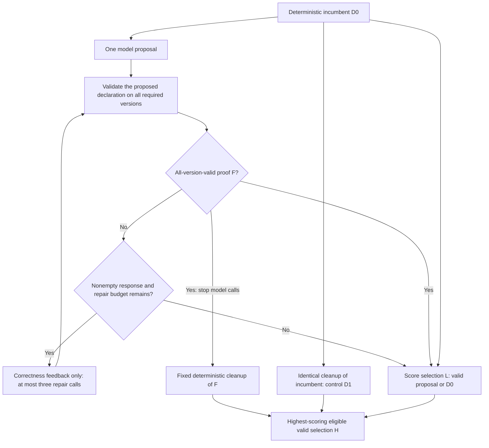

# Deterministic optimization plus model proposals

The current model experiment starts from the deterministic portfolio's selected
proofs. Its first combination is therefore:

`deterministic incumbent → one model proposal → correctness-only repair`

[run_combined_matrix.py](../src/run_combined_matrix.py) adds a bounded final
deterministic pass. It consumes the saved repair matrix and makes no model calls.
The [experiment protocol](../results/one_shot/04_combined_deterministic/PROTOCOL.md)
defines the paired control, selection policy and work accounting.



An invalid or empty final proposal contributes only the incumbent fallback.
Neither score selection nor deterministic cleanup feeds back into a model call.

## Run or resume

The original warm-up comparison continues under
[06_parallel_continuation](../results/one_shot/06_parallel_continuation/PROTOCOL.md);
the original stage-04 directory preserves its completed historical work.
The following command illustrates the interface. For a new experiment, supply
its repair directory and a fresh combined output directory.

```bash
python src/run_combined_matrix.py \
  --input results/one_shot/03_repaired_context_ablation \
  --output results/one_shot/04_combined_deterministic \
  --workers 2 --watch
```

Run from the repository root in the `af` environment. `--watch` consumes repaired
cells as they arrive. Without it, the runner processes currently available cells
and leaves an incomplete snapshot if the cohort is unfinished. Repeat the same
command to resume; changes to frozen inputs, implementation or configuration
require a new output directory. The output must be separate from the earlier
experiments.

Each unique `(theorem, proof bytes)` receives one cleanup job. The fifteen
incumbents are controls, and every all-version-valid final model proposal is
eligible for cleanup, including a proposal rejected by the earlier score
comparison. Identical proofs share their cleanup result across cells. A failed
or empty model response falls back to its theorem's cleaned control.

The fixed pass uses the ten established deterministic methods, each bounded by
three rounds, 32 trials and six discovery sites per site batch. It has no repeat
sweep. Candidate edits must improve the combined competition score by more than
0.05 percentage points and pass every required Lean version. This eligibility
gate preserves the underlying compiler evidence; a compatibility rejection is
not labeled a compilation failure.

## Read the outputs

`matrix_config.json` pins the full cohort, method budgets, code, inputs and
reference identities. `jobs/` holds proof-level method checkpoints, trials,
unchanged evaluator evidence and final results. `jobs.json` maps all logical
origins to these physical jobs. `cells/` records each model/context/theorem
selection. `RUN_STATUS.md` and `summary.json` expose progress.

The comparison keeps four scores separate: the original deterministic incumbent,
that incumbent after extra cleanup, the previous model-and-repair selection,
and the combined selection after cleanup. The model branch's gain is measured
against the cleaned deterministic control. Extra control-plus-proposal cleanup
is not an equal-total-compute comparison; counts must distinguish logical uses
from shared physical work.

An unavailable discovery leaves the cleanup explicitly incomplete even if its
best saved proof passes Lean. Completed evidence, including this incomplete
outcome, is reused on resume rather than silently retried. Full-condition scores
and submission exports require every corresponding cleanup to complete.

The Python `cleanup_proof(...)` function in the runner accepts an evaluator,
dataset row, full proof, output folder, pinned provenance and an optional guard
that checks reference and source identities. The matrix wrapper supplies that
guard and deduplication. Reference preparation remains a separate operation;
this runner only reads the existing cached denominators.

## A new benchmark batch

The execution runners derive their cohort from the supplied dataset; 225 cells
and fifteen controls are properties of this experiment. Use new output
directories and pass the same `--dataset`, `--environments` and `--cache` to
the deterministic, one-shot, repair and combined runners. Prepare any new
reference measurements once with `process_benchmark.py`, then reuse that cache.

The model input JSONL must contain every dataset name exactly once, and each
combined-stage incumbent must pass every required version. The general
deterministic batch runner optimizes the combined score and can accept a
compatibility tradeoff, so its output must satisfy that stronger validity
condition before becoming a seed for this experiment. All fifteen incumbents
used here meet it.

The reporters derive their denominators from the experiment manifests. The
current evidence auditors still use repository-specific warm-up dataset,
reference-export and incumbent paths. Those paths need to become configurable
before claiming the same audited workflow for a different batch. Saved
manifests also pin artifact paths and source hashes; resume requires matching
inputs and implementation.

## Report and audit

```bash
python src/report_combined_matrix.py \
  --input results/one_shot/04_combined_deterministic
python src/audit_combined_matrix.py \
  --input results/one_shot/04_combined_deterministic --complete
```

The reporter writes readable comparisons, per-problem/source CSVs, paired context
effects and complete individual-condition submissions. The auditor checks the
saved compiler evidence, score arithmetic, accepted transitions, selection,
deduplication, implementation pins and unchanged reference cache without model
calls or Lean compilation. Omit `--complete` for an explicitly partial audit
while jobs are running.

The completed [engineering pilot](../results/one_shot/04_combined_deterministic/PILOT.md)
shows the first observed interaction between the model and deterministic cleanup;
it is separate from the full-condition benchmark results.
