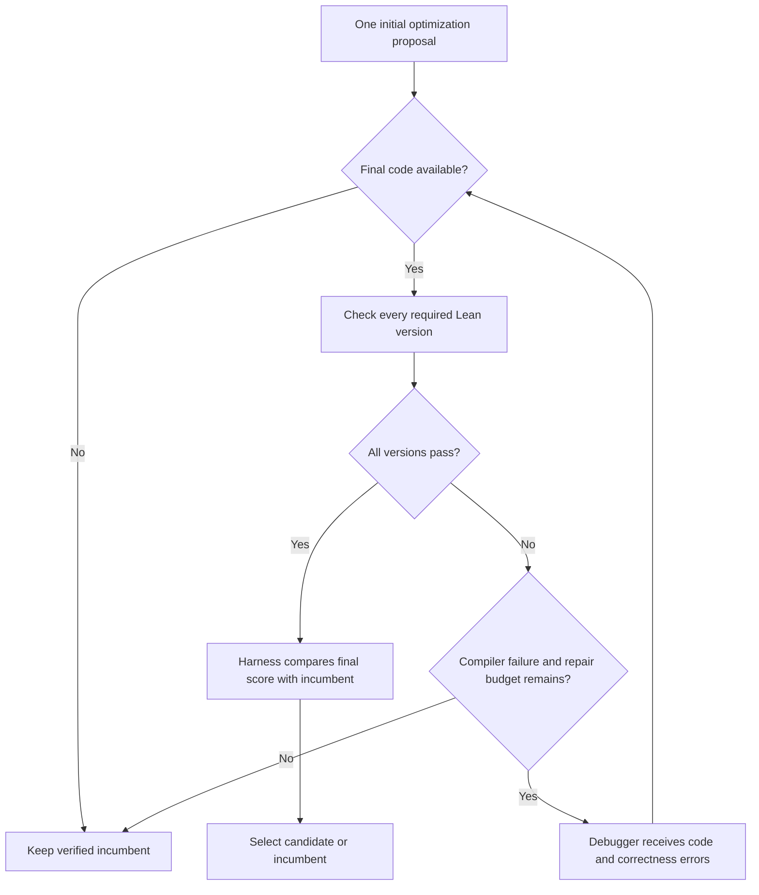

> Historical experiment protocol. Its drivers are preserved at [Git checkpoint `bfb2ade6`](https://github.com/epfl-lara/proof-reduction-competition/tree/bfb2ade6); use [ARCHITECTURE.md](ARCHITECTURE.md) for current commands and APIs.

# One proposal with correctness-only debugging

The model makes one initial optimization proposal. If that proposal is not valid
Lean, a debugger may make **up to three correction calls**. The first candidate
that passes every required version stops the loop. No candidate length,
heartbeat count, score, reward, or improvement decision is returned to the model.
The harness compares performance only after the loop has ended.

This extends the direct-output experiment in [ONE_SHOT.md](ONE_SHOT.md). Those
initial requests and results stay unchanged. Repairs are separate artifacts, so
we can compare the same initial proposal before and after compiler feedback.
This is one optimization proposal plus debugging, not a single model request.

## Interface and control flow

[run_validity_repair.py](https://github.com/epfl-lara/proof-reduction-competition/blob/bfb2ade6/src/run_validity_repair.py) reads a frozen one-shot
directory. It selects completed initial cells by request hash or by model,
condition and theorem. For each cell it:

1. Retains already-valid proposals without another request.
2. Builds a dedicated correctness prompt from the exact statement, current
   candidate, known-valid incumbent, bounded preceding source and required
   versions. It does not replay the optimization prompt or tactic-cost context.
3. Gives the debugger bounded compiler errors and unsolved goals, labeled by
   version. Long messages preserve their goal target. No source-line numbers are
   guessed from the temporary instrumented file.
4. Checks the returned declaration through the existing evaluator on all required
   versions. It stops at the first all-version-valid result, even when its
   competition score is worse. Otherwise it supplies correctness feedback again,
   within the three-round limit.
5. After stopping, accepts that final valid candidate only if its combined score
   exceeds the incumbent by the existing 0.05-percentage-point margin. It otherwise
   exports the known-valid incumbent. There is no further call based on this choice.

The validity predicate requires actual successful checks for the exact required
version set. An aggregate evaluator `passed` status alone is insufficient when
the primary version passed but another version failed.



There is no arrow from score comparison back to the model. Each debugger call
consumes one of the three permitted rounds; unavailable verification stops the
attempt. Although the evaluator records measurements during each check, only its
filtered correctness view reaches the debugger.

An empty initial response has **no candidate to debug** and is recorded separately;
the harness does not silently regenerate it. A nonempty malformed or truncated
initial response can receive output-contract corrections, labeled `output_recovery`
separately from `compiler_repair`. An empty repair response ends that attempt.
Transport failures and unavailable environments remain infrastructure outcomes;
they are not scored as model reasoning failures or automatically retried.

Returning the incumbent is allowed and explicitly counted as unchanged. This
does not count as an optimization improvement. The bounded debugger cannot
guarantee that every new proposal becomes valid; incumbent fallback keeps the
selected submission valid when repairs fail.

## Run selected completed cells

```bash
python src/run_validity_repair.py \
  --input results/one_shot/01_context_ablation \
  --output results/one_shot/02_validity_repair/my_cohort \
  --models Qwen/Qwen3.5-397B-A17B \
  --arms goals \
  --name CallElimCorrect.substOldPostSubset \
  --max-rounds 3 --workers 1
```

Repeated `--cell REQUEST_SHA256` selects exact initial cells. Omitting selectors
requires every indexed initial result to exist; it does not race ahead of an
unfinished generation run. Existing cells and completed repair rounds are reused
on resume. A request-start marker without a saved response becomes indeterminate
and is never resampled. Changes to the cohort, implementation or generation
configuration require a new output directory.

Every repair inherits its model, temperature, reasoning settings and output cap
from the initial request: currently **0.3**, **high**, **32,768 tokens including
reasoning**. It uses the existing RCP client and the same pinned Lean evaluator.
The runner verifies the cached reference values and environment identities before
any model calls; it never remeasures a reference.

Saved round artifacts include the exact messages, correctness feedback, request
start marker, provider usage and final content, and all-version evaluation.
Reasoning text is not saved. A model/condition submission JSONL is exported only
when all initial benchmark names are present, preventing a pilot cohort from
being mistaken for a complete submission.

## Process the full arriving matrix

The original warm-up study now continues in
[06_parallel_continuation](../results/one_shot/06_parallel_continuation/PROTOCOL.md),
which reuses all 180 completed cells from the archived stage 03. Use that
protocol for the shared request limiter and exact launch commands. The original
stage-03 directory remains a historical snapshot; resuming it would duplicate
the continuation's work. The commands below describe the original interface;
use fresh output directories for a new experiment.

[run_repair_matrix.py](https://github.com/epfl-lara/proof-reduction-competition/blob/bfb2ade6/src/run_repair_matrix.py) can consume initial cells
while the direct-output runner is still working:

```bash
python src/run_repair_matrix.py \
  --input results/one_shot/01_context_ablation \
  --output results/one_shot/03_repaired_context_ablation \
  --reuse results/one_shot/02_validity_repair/01_engineering_pilot \
  --reuse results/one_shot/02_validity_repair/02_deepseek_pilot \
  --per-model 1
```

It declares the complete initial cohort before considering repair outcomes,
waits for new initial results, and enforces separate per-model concurrency without
letting slow requests block other models. Exact completed pilot cells are copied
and reused; incompatible or partial pilot artifacts are rejected or left unused.
It never overwrites an existing repair cell or requests an initial generation.

`matrix_config.json` records the fixed cohort. `arrivals.json` pins initial-result
hashes as they appear; the final audit `config.json` exists once all initial
results have arrived. `RUN_STATUS.md` tracks worker progress. A terminal,
incomplete initial run leaves the repair matrix incomplete and resumable.

Generate the separate score/call-cost report and verify completed evidence with:

```bash
python src/report_repair_matrix.py --input results/one_shot/03_repaired_context_ablation
python src/audit_validity_repair.py --input results/one_shot/03_repaired_context_ablation --complete
```

The report supports partial snapshots; full-condition means require every
configured theorem. The auditor requires the final initial-result manifest and
does not invoke Lean or a model. The [full protocol](../results/one_shot/03_repaired_context_ablation/PROTOCOL.md)
records the measurement boundaries and interpretation limits.

[analyze_repair_budgets.py](https://github.com/epfl-lara/proof-reduction-competition/blob/bfb2ade6/src/analyze_repair_budgets.py) replays saved terminal
trajectories at repair budgets 0, 1, 2 and 3, without further calls. It reports
validity, selected-score gains and additional token use for each prefix. These
are shared-prefix comparisons, not independently sampled budget experiments;
full-condition means require every declared theorem.

## Harness building blocks

[validity_feedback.py](https://github.com/epfl-lara/proof-reduction-competition/blob/bfb2ade6/src/validity_feedback.py) provides two pure helpers:

```python
from validity_feedback import all_versions_passed, build_validity_feedback

evaluation = evaluator.evaluate(name, declaration, versions="all")
if not all_versions_passed(evaluation, required_versions):
    feedback = build_validity_feedback(evaluation, required_versions)
```

`build_validity_feedback` whitelists correctness information, removes measurement
markers and redundant wrapper errors, and bounds the JSON and per-error size.
The evaluator still computes measurements internally; the debugger receives only
the filtered view. Ordinary compiler diagnostics can include downstream errors
from the surrounding source file, so bounded messages prioritize the first actual
errors rather than claiming perfect source-span isolation.

`repair_cell(...)` in the runner supplies the resumable bounded loop for an
existing proposal. Its final result preserves both proposal validity and the
harness's separately selected incumbent/candidate. The original direct-output
experiment, repair pilot, and any later full repair matrix must retain distinct
denominators and model-call accounting.

## Combine with deterministic optimization

The model's initial proof already comes from the deterministic portfolio. The
[combined experiment](../results/one_shot/04_combined_deterministic/PROTOCOL.md)
adds a fixed deterministic cleanup after debugging, and applies the identical
cleanup to the original incumbent as a control. It considers valid proposals
that lost the initial score comparison as well as accepted proposals. Cleanup
outcomes never trigger a new model request or enter compiler feedback.
