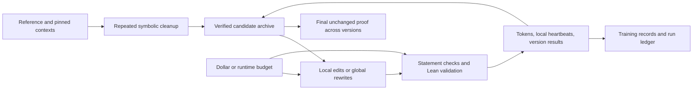

# Proposed development plan for both tracks

**Execution update:** [staged warm-up experiments](../results/deterministic/README.md) now cover
all 36 reference checks, ten deterministic methods, and two completed repeat sweeps.
Follow those reports for current scores, concrete accepted edits, costs, and the
next experiment; the model and training stages below remain proposals. The
[measured findings](../results/deterministic/FINDINGS.md) identify continuation through unvisited
discovery sites as the next isolated scheduling experiment.

**Recommendation:** build a shared search engine around the existing evaluator; make repeated symbolic cleanup plus a frozen model competitive first. Train a small editor on verified improvements, compare expert iteration with GRPO, and keep final-data adaptation as an optional experiment. Large-model deployment should earn its place through score gained per unit of time.

The deterministic proposal runner and evaluator are implemented; model proposal
loops and training jobs below remain proposals. Literature mechanisms and limits
are summarized in [LITERATURE.md](LITERATURE.md); hardware and framework choices are
in [MODELS.md](MODELS.md).

## What to build first

| Priority | Deliverable | Acceptance evidence |
| --- | --- | --- |
| P0 — complete | Project/version setup and cached references | Every requested environment is pinned and all 36 local reference measurements are prepared and reused. |
| P1 — complete | Repeated deterministic cleanup | Ten methods and two bounded sweeps over all 15 warm-up proofs, with per-edit outcomes, stop reasons, and complete score vectors. |
| P2 | Shared model proposal loop and budget scheduler | Valid incumbent survives errors/interruption; closed dollars and open runtime are bounded; final output passes all configured version checks. |
| P3 | Qwen3.8-27B versus Qwen3.6-35B frozen pilot | Matched-budget results choose the initial editor and serving topology. |
| P4 | Verified data pipeline and LoRA SFT | One small end-to-end training run improves a held-out set, including reloaded-checkpoint inference. |
| P5 | GRPO and offline preference alternatives | Improvement over frozen/SFT search at equal inference budget, with training cost reported separately. |
| P6 | Large quantized model and test-time adaptation ablations | Demonstrated extra score under the complete resource cap; rule questions resolved before final-data training. |

All **15 warm-up problems and 36 theorem/version reference measurements** are
prepared (October 2, 2026); optimization reuses these cached values. The repository
has deterministic proposal generation, resumable experiments, source-token and
local-heartbeat scoring, per-version validation, and reward methods. It does not
yet have model proposal generation, a training corpus builder, or a trainer. The
measured deterministic baseline in `results/deterministic/` is the comparison point for those
future experiments.

## Shared harness

Use one implementation with separate model/budget configurations and run logs for the two tracks. Suggested future modules under `src/proof_search/`: `context`, `transforms`, `proposers`, `archive`, `scheduler`, `budget`, and `run`. Training-specific data/adapters can live under `src/proof_training/`.



The proposal loop should work as follows:

1. Load exact theorem, source context, available declarations, and cached reference metrics. Preserve the original as a fallback candidate after checking it under the selected environments.
2. Run a small syntax-aware transformation menu: delete unused tactics/local facts; prune explicit lemma lists; collapse redundant blocks; replace broad automation with a verified explicit result or simpler tactic; try direct existing lemma applications. Never assume a shorter replacement has fewer heartbeats. Test `simp?`/`exact?`-style suggestions only where available, and verify their emitted code separately.
3. Repeat successful cleanup passes until no menu improvement remains or the verifier budget is exhausted. Record which stopping condition occurred. Invalid intermediate edits are proposals, never incumbents. Recheck the assembled declaration after composing edits.
4. Give the model one bounded action: replace a local span, rewrite a subproof, or occasionally rewrite the whole proof. Provide exact statement, relevant goal/context, before/after score target, version labels, and a few applicable transformations. Treat planner/editor/debugger as logical operations; they need not each consume a separate model call.
5. Validate cheap format/statement constraints first, then compile in the primary environment. Reuse cached identical candidates. Check surviving candidates on the other listed versions before selecting by combined score. A partial version pass is provisional, not a compatibility estimate. Keep a small exploration quota for longer proofs that may improve heartbeats or compatibility.
6. Keep a bounded archive: highest combined score, lowest heartbeats, shortest source, strongest compatibility, plus a few structurally different valid proofs. A beam of roughly 4–8 is a pilot choice. Do not discard an incumbent because a newer proposal is longer, times out, or fails.
7. Stop by explicit budget; select the best fully evaluated candidate, validate the exported declaration, and write all problem IDs to submission JSONL. Record fallback use and omissions in the full-benchmark denominator.

The target proof must be unavailable as an imported theorem in the evaluation context. Retrieval should only expose declarations accessible before the target; avoid accidental self-reference or importing the original result. Extra top-level helpers, new imports/dependencies, and syntax extensions cannot enter the submission. Local `have`/`let` and existing library lemmas are the useful structural rewrite space. See the [submission contract](../RULES.md#proof-submission-contract).

**Measurement:** keep dataset reference lengths and cached local reference heartbeats fixed throughout a run. Heartbeats count Lean work rather than elapsed CPU time, but exact counts can change with compiler, library, options, and runtime conditions; local consistency matters. Store those fingerprints. Use wall time for search scheduling and the 48-hour budget, never as a substitute denominator. Treat tiny heartbeat differences as ties during search until a separate calibration experiment establishes a useful tolerance. Any repeat measurements belong to that calibration experiment, not automatic reference remeasurement inside rewards.

Every candidate record should include problem/family ID, parent and candidate hashes, exact code, operation/span, prompt and model revision, environment fingerprints, per-version verdicts, all metric components, timeout/infra status, verifier time, generated tokens, and dollars or GPU allocation. Save the accepted archive atomically so a crash cannot lose the best proof.

## Closed track: maximize improvement under US$3 per problem

The [saved rules](../RULES.md) allow arbitrary harnesses but require **all** API calls, retries, and discarded candidates to count at public list prices. Use a per-problem ledger with atomic reservations for in-flight requests. Admit a request only if its worst-case billable input/output/reasoning cost fits the remaining cap; reconcile against provider usage afterwards. Treat cache-read/write, batch, and reasoning billing according to that provider's published categories without double-counting them. A subscription or discounted invoice is not the list-price accounting rule.

Proposed initial allocation: $1.20 for diverse/global proposals, $0.90 for targeted local edits, $0.60 for bounded repair or a final alternative, and $0.30 headroom. These are scheduling envelopes, not required spend. Set an ordinary stop target of $2.70 and a hard maximum of $3.00 including pending requests. Unused money from another theorem does not raise this theorem's cap.

Run symbolic cleanup before paid generation. Start with a few meaningfully different strategies rather than many copies of one prompt. Compare resampling against at most one repair of a promising near-valid candidate; do not allow unlimited debug loops. Cache local retrieval and successful transformations. Charge any embedding, judge, or auxiliary model calls attributable to a problem; use deterministic selection from compiler metrics wherever possible.

Select the API model from a two-model pilot using actual Lean improvement per dollar. Freeze model versions, prompt templates, and price snapshots for the submission run. Preserve enough usage evidence to regenerate the per-problem cost table and reproduce the proof-selection policy.

## Open track: frozen search → SFT → GRPO

### Data and SFT

Start from [LeanPolish's published edits](https://huggingface.co/datasets/leanpolish-anon/lean-proof-compression) plus our own open-model/symbolic edits on non-benchmark project proofs. Inspect data licenses and pair-audit flags. Port/reverify examples in their exact source environments, and record which versions have actually been checked. Do not attach arena compatibility labels to single-version historical data.

Use splits by theorem family and source project, with deduplication across statements, variants, and intermediate edits. Exclude exact warm-up statements from training when measuring held-out improvement; keep public warm-up results as development evidence. After full release, distinguish any adaptation experiments from the clean held-out evaluation. Avoid interpreting near-duplicate proofs in different splits as generalization.

For each pair, supply the original statement/proof, relevant source context, desired objective, and version metadata; supervise only the replacement proof or well-specified local edit. Reconstruct and verify the full declaration. Keep local-edit and whole-proof formats explicit. Preserve every candidate outcome, including valid non-improvements, invalid proposals, and timeouts. Build ranker/preferences from complete menus or logged sampling probabilities, not the incidental order of first-success search.

Begin with a 32–64-example pipeline check, then a 5K–20K-pair LoRA pilot. Mix simple deletions, explicit tactic replacements, heartbeat improvements, version repairs, and larger rewrites. Balance sources and length ranges. Re-run cleanup on model outputs so the model is evaluated against the actual symbolic baseline. Keep a replay fraction when refreshing data through expert iteration; tune that fraction on held-out results.

### Rewards and GRPO

For a valid candidate with all required versions available, define the local canonical score on a 0–1 scale:

```text
L = 1 - candidate_source_tokens / dataset_reference_tokens
H = 1 - candidate_primary_heartbeats / cached_local_reference_heartbeats
C = number_of_versions_compiling_unchanged / number_of_required_versions
S = (L + H + C) / 3
```

This follows the arena's three-axis structure with our local heartbeat denominator and explicit local primary version. The evaluator handles invalidity and unavailable denominators; do not reconstruct a partial combined score in the trainer. The original is approximately `S = 1/3` if it passes all versions, not zero: reductions are zero, compatibility is one. Keep the reference denominator fixed when iterating from a better incumbent.

Use `Evaluator.evaluate` for component diagnostics and `Evaluator.reward_batch(..., metric="combined", versions="all")` for complete canonical rewards. Missing projects/baselines raise `EvaluationNotReady`; retry or drop the affected training group as an infrastructure issue rather than turning it into model failure. A configured candidate timeout is a model outcome under that fixed verifier policy; machine outages are different.

The API's default invalid reward is zero and valid reductions may be negative. Therefore raw score can rank a severe valid regression below an invalid completion. For a first training ablation, use a **separate, explicitly shaped reward**:

```text
invalid declaration:                    R_train = -1
valid and completely measured:          R_train = 1 + clip(S, -1, 1)
missing infrastructure/measurement:      no training reward; retry/drop group
```

This prioritizes validity and bounds outliers; it saturates extreme regressions and is not the reported competition metric. Log unclipped `S` and its axes alongside it. Final search selection always uses the canonical score among valid candidates. Compare shaping against the existing raw-score adapter rather than silently changing evaluator behavior.

Start GRPO with groups of 4, then compare 8 when verification throughput permits. Use bounded outputs, length-aware batching, and a queue of isolated CPU Lean workers so GPUs do not wait on serialized checks. Track effective group variance, valid fraction, truncation, KL if enabled, and reward latency. Repeated identical rewards provide no useful relative learning signal. Do not inject an unsampled incumbent as if it were an on-policy rollout; use it as an archive/data reference instead.

Initially compare group-standard-deviation normalization with mean-centered advantages; [TRL documents this distinction](https://huggingface.co/docs/trl/main/en/grpo_trainer). Treat KL, learning rate, and rollout length as explicit ablations. Measure generated model tokens for training cost, but reward Lean source tokens in the final proof body; hiding text in reasoning/comments must not change proof-length reward.

If all-version rewards are too slow, primary-version length/heartbeat rewards may be used as a **labeled surrogate stage**. Do not report them as combined score. Follow with full-version validation/training before selecting the final checkpoint. If online GRPO cannot outperform verified expert iteration or offline preference training at acceptable cost, keep the simpler winner.

### Test-time GRPO on the final problems

The idea is plausible: each task already supplies a valid starting proof and Lean can verify candidate improvements. [TTT-Discover](https://arxiv.org/abs/2601.16175v2) is the closer conceptual precedent; [TTRL](https://arxiv.org/abs/2504.16084v3) is useful background, but we do not need its majority-vote reward estimate.

Treat it as an optional branch until the rule questions below are resolved. Develop the method first on held-out problems treated as simulated final tasks. Compare: frozen best-of-k/beam search, extra frozen search using the same total GPU time, local expert iteration, and LoRA GRPO. Start from the same checkpoint and candidate archive in each comparison.

Prefer resetting a small adapter per problem for the first experiment. A shared adapter across final problems is a different, order-dependent experiment and must record task order and cumulative training data. In either case retain the best verified proof independently of the final model state. Count rollout, verification, updates, checkpoint loading, and any conversion as part of a conservative end-to-end reproduction schedule. Do not move final-data training outside the measured run merely by labeling it post-training.

For 50 problems, 48 hours gives a simple average of **57.6 minutes per problem**. Reserving eight hours for loading, final checks, and recovery leaves 48 minutes per problem on average. Actual scheduling should favor problems with remaining score headroom. These are planning allocations; measure throughput before promising them. A 192 GPU-hour total does not authorize using more than four A100s concurrently.

## Experiments that would establish useful progress

| ID | Comparison | Question |
| --- | --- | --- |
| E0 | Original vs one cleanup pass vs repeated cleanup | How much improvement comes from deterministic transformations alone? |
| E1 | Plain prompt vs goal/context prompt, same frozen model | Does richer context improve accepted edits per generation? |
| E2 | Symbolic + frozen model vs either alone | Are their improvements complementary? |
| E3 | Greedy incumbent vs small archive/beam | Do intermediate or diverse proofs justify extra verifier work? |
| E4 | Fixed/random action ordering vs learned selector | Can we save verification cost using unbiased candidate outcomes? |
| E5 | Frozen vs SFT vs expert iteration vs GRPO/IRPO | What does training add with identical search budgets? |
| E6 | Small BF16 model vs large quantized model | Which wins on score versus actual four-A100 elapsed time? |
| E7 | Frozen extra search vs test-time adaptation | Does weight updating beat spending the same compute on more search? |

Report every axis, canonical combined score, primary validity, per-version pass matrix, and score change relative to the original. Include all problems, failures, fallbacks, generated tokens, model spend, verifier calls/time, and runtime. Show per-source results and paired per-problem differences. Repeat stochastic seeds where feasible; 15 public problems are too few for confident broad ranking claims. Separate offline training cost from inference cost while also reporting the full research cost.

The most promising modest research contribution is a **version-aware action selector** predicting expected positive score gain per verification cost. Compare it against fixed ordering, random ordering, and lexical retrieval. A second direction is measuring which dependency/tactic choices preserve compatibility across held-out versions. More agent roles or a larger model alone would not establish a new method.

## Proposed schedule

| Window | Target |
| --- | --- |
| Oct 2–8 | Resolve environment coverage; run E0; add resumable archive and budget ledger. |
| Oct 9–15 | Run closed API and small open-model pilots; E1–E3; collect verified training data. |
| Oct 16–23 | LoRA SFT, expert iteration and small GRPO comparison; keep a frozen baseline usable. |
| Oct 24–31 | Freeze the main harness; test larger quantization/adaptation only if earlier milestones pass; rehearse reproduction and draft report. |
| Nov 1–6 | Full-benchmark runs with separate track logs; optional authorized adaptation within the measured resource schedule. |
| Nov 7–8 | Final validation, proof/code archives, cost/runtime evidence, and report submission. Verify exact deadline timezone. |

These are work proposals, not launched jobs or reservations.

## Rule questions to resolve before the final run

The [pinned Space rules](https://huggingface.co/spaces/delta-lab-ai/lean-refactor-arena/blob/d9e46ee13c822925fb3031b0a0eac53b51631198/app.py) allow post-training and harnesses. They do not explicitly resolve all of the following. No organizer has been contacted as part of this update.

1. Is weight updating on the released final tasks allowed, and must every update/data-generation step fit inside the four-A100, 48-hour reproduction run? Is sequential cross-problem adaptation permitted?
2. What host CPU/RAM and offloading resources are allowed for open-model serving? Are any external model/prover services allowed during reproduction, and how are they budgeted? Plan for local open-weight models and local Lean by default.
3. Are closed-model-generated training examples allowed for an open entry? Use open-model/symbolic supervision initially, and disclose teacher provenance rather than assume permission.
4. Which report contract is current? The saved Space says **3–9 pages**, **Budget accounting**, and `/VERICODEGEN`; the [workshop page](https://vericodegen.github.io/) says **4–9 pages**, **Budget**, and `/VERICODEGEN_Competition`. Drafting 4–9 pages satisfies both length ranges, but use the authoritative template/organizer answer for headings and venue.
5. Confirm the final benchmark's exact primary heartbeat environment, any missing heartbeat denominators, and deadline time/timezone. Our local score should remain labeled local until calibrated against organizer results.
