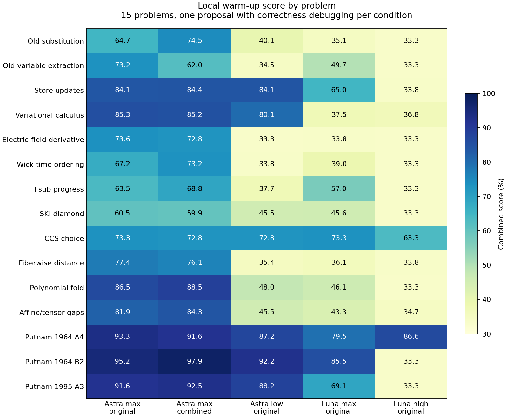

# What Astra did better

Astra/max's main improvement was changing the structure of proofs: reusing
stronger library lemmas, choosing a better induction, factoring repeated
arguments, and supplying explicit constructors instead of asking automation to
discover them. Deterministic transforms account for little of its final score
on these 15 warm-up problems. Source inspection and correctness debugging were
part of the successful model workflow.

This is an analysis of **120 completed cells**: Astra/max, Astra/low, Luna/max
and Luna/high, each on the same 15 problems with two starting proofs. It adds
no model calls, Lean compilation or reference measurements. Luna/medium is
excluded from this snapshot. These are local scores, not new official grades.

## How much did determinism contribute?

| Setup | Mean competition score |
| --- | ---: |
| Fixed deterministic baseline D0 / repeated-cleanup control D1 | 46.248122% |
| Astra/max from original, no deterministic transforms | 78.093430% |
| Astra/max from D0, before cleanup | 78.638454% |
| Astra/max from D0, after cleanup and selection | 78.970302% |

The complete combined arm leads the original arm by **0.876872 percentage
points**. Of this difference, **0.331848 points** is the measured contribution
of cleanup to the same generated proposals; cleanup improved 5/15 cases.
The remaining **0.545024 points** is a difference between separate generations
from different seeds, not an isolated causal estimate of preprocessing.

The combined arm wins on 8 problems; the original arm wins on 7. The largest
differences go in both directions: +9.743180 points on old substitution and
−11.222207 on old-variable extraction. Astra/max from the original beats D0
on **all 15 problems**, not just the Putnam tasks. Both Astra arms improve
every seed and pass every required version without fallback to the seed.

Thus deterministic transforms were unnecessary for Astra/max's large gain in
this experiment. This does **not** show that cleanup of the original-arm model
outputs would be useless: that missing ablation has not been run. The original
arm also retained the fixed strategy cards chosen using D0; it is a
no-transforms comparison, not a no-bank/no-tools comparison.

## Same prompt and tools, different results

All numbers below are the mean selected score across the same 15 declarations.
All eight completed conditions have **100% compatibility**. Scores use the
same fixed original token denominators and cached local synchronous heartbeat
references; failed or regressive proposals are handled by the saved selection
policy. The analyzer also checks raw final-proposal evaluations separately.

| Model / effort | Original-arm score | Combined-arm score | Original-arm token reduction | Original-arm heartbeat reduction |
| --- | ---: | ---: | ---: | ---: |
| Astra / max | 78.09% | 78.97% | 54.06% | 80.22% |
| Astra / low | 57.22% | 60.72% | 32.73% | 38.94% |
| Luna / max | 53.05% | 59.74% | 17.11% | 42.02% |
| Luna / high | 39.26% | 50.58% | 4.99% | 12.79% |

Astra/max's original-arm score exceeds Astra/low on 14/15 problems and
Luna/max on 14/15. The exceptions are small: Astra/low wins store updates by
0.083794 points, and Luna/max wins CCS choice by 0.018638 points.
Deterministic seeding/cleanup contributes much more to Luna's selected result:
the combined-versus-original difference is 6.70 points at max and 11.32 at high.



The difference is particularly large in the project declarations. This
post-hoc grouping describes these tasks; it is not a new benchmark split.

| Original arm | 12 project declarations | 3 Putnam declarations |
| --- | ---: | ---: |
| Astra / max | 74.27% | 93.40% |
| Astra / low | 49.23% | 89.21% |
| Luna / max | 46.80% | 78.02% |
| Luna / high | 36.31% | 51.07% |

## What changed in the proofs

The [case studies](CASE_STUDIES.md) link original and generated declarations,
diffs and command traces, and cover all 15 problems. The most informative
mechanisms are:

1. **Reuse an abstraction that removes an entire argument.** In store updates,
   Astra replaces induction over update derivations with existing length,
   definedness and state-commutation lemmas. In variational calculus, it uses
   a continuous inner-product function, a bump function, and a library theorem
   giving positivity of the integral, removing a detailed norm-bound argument.
2. **Choose the induction object that already carries the needed invariant.**
   For old-variable extraction, it inducts on `NormalizedOldExpr` evidence
   rather than the expression syntax. Constructor cases then directly supply
   the useful hypotheses. A local append-subset lemma shares branch reasoning.
3. **Make the proof term explicit where search is expensive.** In Fsub progress,
   explicit reduction constructors and canonical-form lemmas replace repeated
   `grind`. Tokens increase from 408 to 443, but heartbeats fall from
   59,833.580 to 577.335, a 99.04% reduction. Astra/low shortens the proof to
   360 tokens while retaining almost all of its heartbeat cost.
4. **Factor a mathematical identity and reuse it.** In Putnam 1995 A3, a local
   digit-replacement identity, a divisibility sum and a coprimality argument
   replace repeated long arithmetic derivations: 4,085 → 292 tokens.
   Similar factoring appears in polynomial folding, Wick ordering and the
   electromagnetic derivative proof.

These are observations about final source, not claims about hidden reasoning.
They are also not rules that `simp` or `grind` are always bad. Astra still uses
automation to close bounded arithmetic and rewriting goals. The useful change
is arranging the proof so that those tactics have less work to discover.

## Source lookup and debugging

Counts below sum both 15-problem arms. A validity check is a recorded invocation
of the multi-version checker, not one Lean process or one version. Completion
tokens include the provider's reported reasoning and output usage across
initial and outer repair calls; they are not dollar or wall-time comparisons.

| Model / effort | Completion tokens | Model calls | Outer repairs | Validity checks | Failed checks | Cases with first check failing |
| --- | ---: | ---: | ---: | ---: | ---: | ---: |
| Astra / max | 185,145 | 30 | 0 | 58 | 28 | 16/30 |
| Astra / low | 68,397 | 33 | 3 | 40 | 13 | 9/30 |
| Luna / max | 476,952 | 33 | 3 | 143 | 104 | 25/30 |
| Luna / high | 162,827 | 33 | 3 | 87 | 58 | 22/30 |

Astra/max used **61.18% fewer completion tokens than Luna/max**, while
producing much better proofs and encountering fewer failed checks. Its
advantage is not explained by a larger number of retries. Astra/low spends
less inference overall, but loses much of the score on project declarations.

All 30 Astra/max cases contain `rg` or `sed` commands, versus 11/30 Astra/low,
27/30 Luna/max and 20/30 Luna/high. This literal command-presence indicator is
not a retrieval-quality metric. The manually inspected traces show what
matters: looking up actual theorem signatures and inductive constructors,
checking hypotheses, and inspecting alternate pinned versions before building
the replacement proof. Luna/max also searches extensively; tool access alone
does not explain the result.

Astra's zero outer repairs do **not** mean first-try compilation. Sixteen
cases failed the first internal validity check and were debugged inside the
Codex call. There are no additional checker invocations after the first
passing check in any Astra/max case. In 28/30 cases, the checked and final
proofs match after the evaluator's normalization. The other two are the
fiberwise-distance arms: manual diffs show only indentation/line-wrap changes,
and all 30 match when whitespace is ignored. Final declarations were also
evaluated by the harness after generation.

## Limits of the comparison

The analysis verifies **90 initial-request pairs**: prompts and settings are
identical after excluding only model and reasoning effort. However, historical
Astra/max preceded the source-write protection added during Luna recovery;
Astra/low used the later execution policy. This operational difference is
recorded in the [protocol](../10_astra_low/PROTOCOL.md).

Read restrictions were instructions, not filesystem isolation. One Luna/max
original case, affine/tensor gaps, read `src/proof_eval/metrics.py` in three
commands ([trace](cases/12_interleaved_affine_gaps_imply_tensor_gaps/luna_max_original_trace.json),
event lines 23, 33 and 35), outside its intended project/workspace scope.
This is an observed scope deviation, not evidence of numerical candidate-score
feedback; saved Lean validity and arithmetic still stand. A production tool
interface should enforce the allowed read scope. The trace review here is not
a comprehensive security audit. Additional checks after a pass occur in seven
Luna/max and four Luna/high cases; those alone do not establish performance
search, since a check can concern the incumbent or another repair output.

RCP's open-model experiments used direct text generation, bounded supplied
context and outer correctness repair. They did not have the same interactive
source lookup and in-call tools, and did have a 32,768-token cap and specified
temperature. The Astra/RCP difference therefore mixes model, interface and
inference-budget effects. The matched Astra/Luna and Astra/effort comparisons
are more informative, but each condition still has only one sampled trajectory
per warm-up problem. There are no confidence or held-out generalization claims.

## Next experiments, in order

1. **Complete the missing cheap ablation:** apply the existing cleanup to saved
   Astra/max original-arm proofs. Reuse cached references; report actual cleanup
   gain, cost and per-case changes. This needs no new model generations.
2. **Match the tools for one open model:** same original proofs, cards, pinned
   source access and correctness-only checker. Separate delivery failures,
   rejected rewrites, repaired validity, seed returns and score improvements.
   Record token and tool budgets explicitly rather than calling unlike runs equal.
3. **Test specific structural cards:** induction on evidence, a shared local
   helper, a stronger library theorem, and explicit constructor witnesses.
   Give each card a trigger and a way to retrieve/check the required types.
   Keep target-specific Astra answers out of evaluation prompts; use other
   declarations or cross-fitting for examples. Test one change at a time.
4. **Train against the working interface:** these verified rewrites can seed
   training-pair construction, but do not assume tool trajectories are needed
   until the matched open-model trial distinguishes proof synthesis from
   retrieval/debugging limitations. Keep score-feedback search for its own stage.

For now, the evidence supports keeping source lookup and correctness debugging
central, with deterministic cleanup as a separately measured option. It does
not support enlarging a generic tactic bank or teaching a universal heartbeat
price for a tactic: costs depend on the goal, context and version.

## Reproduce and inspect

```bash
conda activate af
python src/analyze_astra_strategies.py
```

The plotting step needs NumPy and Matplotlib, available in the local `af`
environment. The [analyzer](../../../src/analyze_astra_strategies.py) checks
selected and model-final proof identity, fixed-denominator score arithmetic,
environment fingerprints and **576 saved version outcomes**. It reconciles
event-derived validity counts with checker artifacts, verifies request parity,
and hashes all consumed JSON/JSONL evidence. This is an evidence audit, not a
new compilation or an audit of every deterministic-cleanup trial.

- [Machine-readable report](report.json), [condition table](conditions.csv),
  [120 per-cell rows](per_problem.csv), [paired Astra results](paired_astra.csv)
- [Input provenance](input_manifest.json), [proof and trace snapshots](cases/)
- [Score-component figure](score_components.png) and editable
  [SVG](score_components.svg); [per-problem SVG](per_problem_scores.svg)

Snapshots contain full declarations to be checked in their pinned project
context, not standalone import-complete Lean modules. Selected and raw final
proofs are separate (`*_model.lean`); a selected proof can be the seed fallback
for a weaker condition. Traces retain commands and visible correctness
outcomes, not reasoning text. Raw experiment artifacts remain unchanged.
